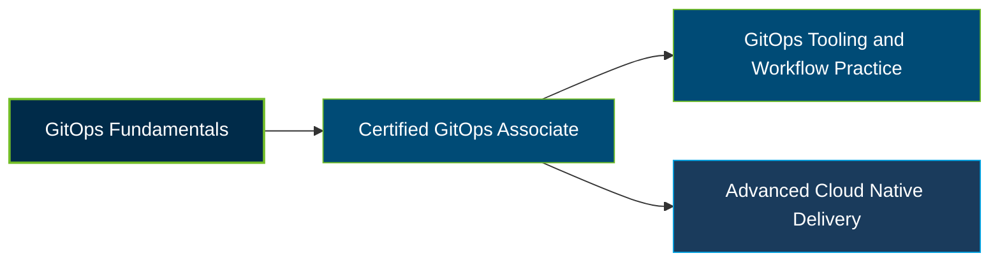

# Linux Foundation Certified GitOps Associate (CGOA) Certification Exam Guide

A dedicated, comprehensive study guide and GitOps reference repository for candidates preparing for the **Linux Foundation Certified GitOps Associate (CGOA) Certification Exam**.

---

## Exam Overview

The Certified GitOps Associate certification validates foundational knowledge of GitOps principles, terminology, and best practices for managing software delivery through declarative configuration and automated reconciliation.

- **Exam Format**: Online, proctored, multiple-choice exam
- **Target Audience**: DevOps engineers, platform and software engineers, and CI/CD practitioners
- **Prerequisites**: None

---

## Core Exam Domains & Knowledge Areas

### 1. GitOps Terminology

- Declarative descriptions, desired state, and state drift.
- State reconciliation, feedback loops, and rollbacks.
- GitOps-managed software systems and state stores.

### 2. GitOps Principles

- Declarative configuration of the desired system state.
- Versioned and immutable state with traceable history.
- Automatic pulling and continuous reconciliation.

### 3. Related Practices

- Configuration as Code (CaC) and Infrastructure as Code (IaC).
- DevOps and DevSecOps practices.
- Continuous integration and continuous delivery (CI/CD).

### 4. GitOps Patterns

- Deployment, release, and progressive delivery patterns.
- Pull-based versus event-driven approaches.
- Reconciler architecture and state store management.

### 5. Tooling

- Manifest formats and configuration packaging.
- State store systems, including Git and alternatives.
- Reconciliation engines such as Argo CD and Flux, and their integration with observability and CI tools.

---

## Certification Path

This is a suggested learning progression, not an official prerequisite structure or successor certification pathway.

---

## Recommended Practice & Study Resources

Combine official certification materials with practical exercises in GitOps workflows and declarative delivery.

- **Official Linux Foundation Resources**: Review the [CGOA certification page](https://training.linuxfoundation.org/certification/certified-gitops-associate-cgoa/) and the [official CNCF CGOA curriculum](https://github.com/cncf/curriculum/blob/master/CGOA_Curriculum.pdf).
- **CertsGate**: Explore [CGOA certification preparation resources](https://certsgate.com/exams/linux-foundation/cgoa) for supplementary study materials and practice questions.
- **Practical GitOps Study**: Use the [OpenGitOps principles](https://opengitops.dev/) to study declarative state, versioning, automated pulling, and continuous reconciliation, and practice with tools such as Argo CD or Flux.
